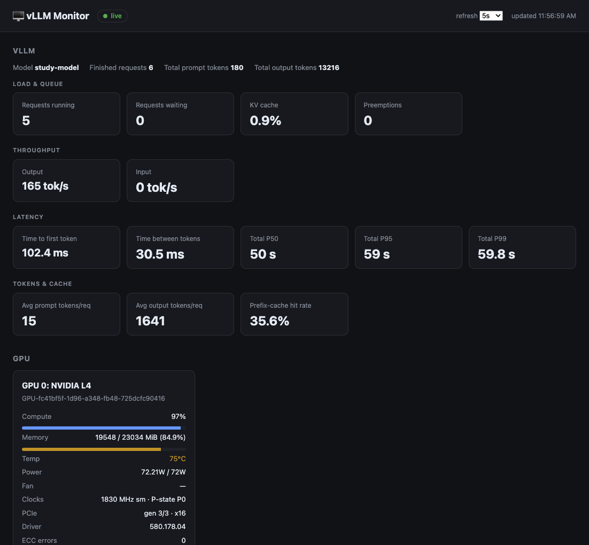
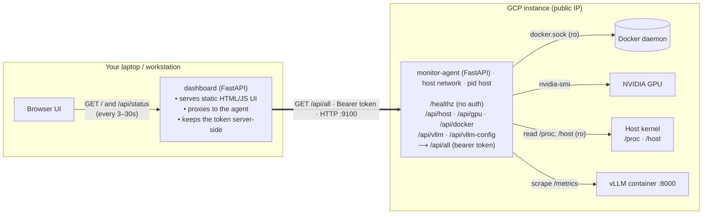

# vLLM Monitor

**vLLM Monitor is a lightweight, self-hosted observability tool for a GPU server
running [vLLM](https://github.com/vllm-project/vllm) in Docker.** It gives you a
single pane of glass over the whole inference stack — the model server, the GPU,
the containers, and the host machine — without the weight of a full Prometheus +
Grafana deployment.

Running an LLM on a cloud GPU instance leaves you with blind spots: Is the server
keeping up, or is a request queue forming? Is the GPU actually busy, or silently
throttling against its power limit? Is the model's KV cache about to overflow? Is
the disk filling up with model weights? Answering these normally means SSH-ing in
and juggling `nvidia-smi`, `docker stats`, `curl .../metrics`, and `df` by hand.
This tool gathers all of that automatically and renders it in one
auto-refreshing web dashboard.

It is built as two small pieces: a read-only **agent** that runs on the GPU
instance and collects everything locally, and a **dashboard** that runs wherever
you like (your laptop) and talks to the agent over its public IP. Every data
endpoint is protected by a bearer token, all host access is read-only, and the
agent is deliberately designed so it can never start, stop, or modify anything —
it only reports status. There is no database, no agent fleet, and no build step;
the whole thing is a couple hundred lines of Python plus a static HTML page.

**What it shows, in one dashboard:**

- **vLLM serving metrics** — throughput, latency percentiles, queue depth, KV-cache, prefix-cache hit rate
- **vLLM launch configuration** — the exact engine args and container runtime flags
- **GPU** — utilization, memory, temperature, power, clocks, PCIe, throttle reasons, ECC, per-process usage
- **Host** — CPU, load, RAM/swap, disk, network, uptime
- **Docker** — container health/status plus per-container CPU/memory



---

## Architecture

The app is split into two independently deployable pieces:



The agent exposes `GET /api/all` (plus per-domain endpoints); the dashboard is the
only client, polling it with a bearer token over the public IP.

### Components

| Component | Runs on | Responsibility |
|---|---|---|
| **agent** (`agent/`) | the GPU instance, in a container | Collects all metrics locally and exposes them as read-only JSON behind a bearer token. |
| **dashboard** (`dashboard/`) | your laptop / any box | Serves the web UI and proxies to the agent. The token stays server-side (never reaches the browser). |

### How the agent collects each signal

| Source | Mechanism | Why it must run on the host |
|---|---|---|
| **Docker** containers + per-container stats | Docker SDK via the mounted `/var/run/docker.sock` (read-only) | The socket is local to the host. |
| **GPU** stats, throttle, ECC, PCIe, processes | Runs `nvidia-smi` | Needs the GPU + driver, injected by the NVIDIA Container Toolkit. |
| **vLLM** serving metrics | Scrapes vLLM's Prometheus endpoint at `http://localhost:8000/metrics` | vLLM binds to `127.0.0.1`; reachable only via host networking. |
| **vLLM** config | `docker inspect` on the vLLM container | Reads the actual launched command + runtime flags. |
| **Host** CPU / mem / net / uptime | Reads `/proc` | Host-visible because the container shares the host PID namespace. |
| **Host** disk usage | `statvfs` on a read-only bind mount of `/` at `/host` | The container's own filesystem isn't the host's. |

### Why a dedicated agent (and not the raw Docker API)?

Exposing the Docker daemon over TCP on a public IP is effectively unauthenticated
root on the box — a well-known attack vector. And `nvidia-smi` / `/proc` can't be
read remotely at all. A small, read-only, token-protected agent solves both and
only ever exposes status, never control.

### Data flow

1. The browser polls the dashboard's `/api/status` every few seconds.
2. The dashboard calls the agent's `GET /api/all` with the bearer token over the public IP.
3. The agent gathers Docker + GPU + vLLM + host data on the instance and returns one JSON snapshot.
4. The dashboard returns it to the browser, which renders the sections.

Rate-based values (token throughput, CPU %, network throughput) are computed from
deltas between consecutive scrapes, so they read `0`/`—` when idle and populate
under load.

---

## Project layout

```
NvidiaPrep/
├── agent/                      # runs ON the GPU instance
│   ├── app.py                  # FastAPI: Docker, GPU, vLLM, host collectors
│   ├── Dockerfile
│   └── requirements.txt
├── dashboard/                  # runs on your laptop
│   ├── app.py                  # FastAPI: proxy + static UI server
│   ├── static/index.html       # the dashboard (vanilla HTML/CSS/JS)
│   ├── Dockerfile
│   └── requirements.txt
├── docker-compose.agent.yml    # deploy the agent
├── docker-compose.dashboard.yml# run the dashboard
├── .env.example                # AGENT_TOKEN + AGENT_URL template
└── README.md
```

---

## Agent API

| Endpoint | Auth | Description |
|---|---|---|
| `GET /healthz` | none | Liveness probe |
| `GET /api/host` | Bearer | CPU, load, RAM/swap, disk, network, uptime, volume sizes |
| `GET /api/gpu` | Bearer | Per-GPU utilization/memory/temp/power/clocks/PCIe/throttle/ECC + compute apps |
| `GET /api/docker` | Bearer | Daemon info + containers (status/health + per-container CPU/mem/net) |
| `GET /api/vllm` | Bearer | vLLM serving metrics (throughput, latency percentiles, KV/prefix cache, …) |
| `GET /api/vllm-config` | Bearer | vLLM container launch config (engine args + runtime flags) |
| `GET /api/all` | Bearer | Combined snapshot — what the dashboard consumes |

### Metrics reference

**vLLM** — requests running/waiting, KV-cache %, input/output tokens/sec, avg TTFT,
inter-token latency, total latency P50/P95/P99, preemptions, prefix-cache hit rate,
avg prompt/output tokens per request, lifetime token totals, finished requests.

**GPU** — utilization, memory used/total/%, temperature, power draw/limit, fan,
SM/mem clocks, P-state, PCIe gen/width, driver version, uncorrected ECC errors,
active throttle reasons, and per-process GPU memory.

**Host** — CPU %, load (1/5/15m), RAM used/total/%, swap, root-disk used/free/%,
Docker volume sizes, network Rx/Tx throughput, uptime, process count.

**Docker** — per container: status, health, uptime, restart count, exit code,
CPU %, memory used/%, plus daemon summary.

---

## Deployment

### Prerequisites

- **Instance:** Docker, Docker Compose v2, and the **NVIDIA Container Toolkit**
  (already present if vLLM runs in Docker with GPUs).
- **Laptop:** Docker (or Python 3.12) and the `gcloud` CLI for SSH/SCP.

### 1. Deploy the agent (on the GPU instance)

```bash
# copy this repo to the instance, then:
export AGENT_TOKEN="$(openssl rand -hex 32)"   # SAVE THIS — the dashboard needs it
docker compose -f docker-compose.agent.yml up -d --build

# sanity checks
curl -s localhost:9100/healthz
curl -s -H "Authorization: Bearer $AGENT_TOKEN" localhost:9100/api/all | head
```

The agent compose grants exactly what each collector needs and nothing more:

- `network_mode: host` — reach vLLM on `127.0.0.1:8000`, and publish port `9100`
- `pid: "host"` — resolve GPU process names (e.g. `VLLM::EngineCore`)
- `/var/run/docker.sock:ro` — inspect containers (read-only)
- `/:/host:ro` — read host disk usage
- GPU reservation (`utility` capability) — run `nvidia-smi`

### 2. Open the firewall (GCP), scoped to your IP

```bash
MY_IP="$(curl -s ifconfig.me)/32"
gcloud compute firewall-rules create vllm-monitor-agent \
  --network=default --direction=INGRESS --action=ALLOW \
  --rules=tcp:9100 --source-ranges="$MY_IP" \
  --target-tags=vllm-monitor
gcloud compute instances add-tags <INSTANCE> --zone <ZONE> --tags=vllm-monitor
```

> Don't open `9100` to `0.0.0.0/0`. For a hardened setup, use an SSH tunnel or a
> TLS reverse proxy instead of exposing the port.

### 3. Run the dashboard (on your laptop)

```bash
cp .env.example .env
#   AGENT_URL=http://<INSTANCE_PUBLIC_IP>:9100
#   AGENT_TOKEN=<the token from step 1>

docker compose -f docker-compose.dashboard.yml up -d --build
open http://localhost:8080
```

Or without Docker:

```bash
cd dashboard && pip install -r requirements.txt
AGENT_URL=http://<IP>:9100 AGENT_TOKEN=<token> uvicorn app:app --port 8080
```

---

## Operations

**Stop the dashboard (local):**
```bash
docker compose -f docker-compose.dashboard.yml down
```

**Agent logs / restart (on the instance):**
```bash
docker logs vllm-monitor-agent
docker restart vllm-monitor-agent
```

**After stopping/starting the GCP instance:**

- The **agent** auto-starts on boot (`restart: unless-stopped`).
- The **vLLM container** does **not** auto-start if its restart policy is `no` — start it manually.
- If the instance uses an **ephemeral external IP**, it changes on restart — update
  `AGENT_URL` in `.env` and bring the dashboard back up. (Reserve a static IP to avoid this.)

---

## Security model

- **Read-only everywhere:** the Docker socket is mounted `ro`, the host root is mounted
  `ro`; the agent inspects but never controls anything.
- **Token-gated:** every data endpoint requires a bearer token (constant-time compared);
  the token lives only on the agent and the dashboard server, never in the browser.
- **No secrets leaked:** the vLLM config collector intentionally omits the container's
  environment variables (which may contain `HF_TOKEN` and similar).
- **Network-scoped:** the firewall rule allows `9100` only from your source IP.

### Configuration (environment variables)

| Variable | Used by | Default | Purpose |
|---|---|---|---|
| `AGENT_TOKEN` | agent + dashboard | — (required) | Shared bearer secret |
| `AGENT_URL` | dashboard | — (required) | `http://<instance-ip>:9100` |
| `VLLM_METRICS_URL` | agent | `http://localhost:8000/metrics` | vLLM Prometheus endpoint |
| `VLLM_CONTAINER` | agent | `vllm` | Container to inspect for config (falls back to any `vllm`-named image) |

---

## Tech stack

Python 3.12 · FastAPI · Uvicorn · Docker SDK · `nvidia-smi` · vanilla HTML/CSS/JS
(no frontend build step). The agent uses only the standard library for `/proc`,
disk, and vLLM-metrics parsing — no extra scraping dependencies.
